<a href="https://github.com/bhuvaneshmp15-glitch">
  
</a>

  
  
  
  




<a href="https://github.com/bhuvaneshmp15-glitch/Deep_Fit_Ai"></a>

  

<a href="https://github.com/bhuvaneshmp15-glitch/automated-claims-engine"></a>

  

<a href="https://github.com/bhuvaneshmp15-glitch/VIDYAPRAYOG-2"></a>

  

<a href="https://github.com/bhuvaneshmp15-glitch/ayursutra"></a>

  




  
  
  
  

