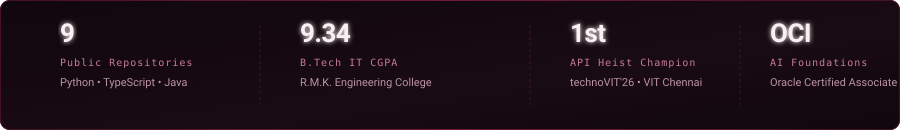

<div align="center">

<!-- Hero Banner -->


<br>

<p align="center">
  <a href="https://github.com/bhuvaneshmp15-glitch">
    
  </a>
  &nbsp;
  <a href="https://www.linkedin.com/in/bhuvanesh-mp">
    
  </a>
  &nbsp;
  <a href="https://github.com/bhuvaneshmp15-glitch/LeetCode">
    
  </a>
  &nbsp;
  
</p>

</div>

---

### 01 // Overview

I am an Information Technology undergraduate at **R.M.K. Engineering College**, Chennai (2025–2029) maintaining a **9.34 CGPA**.

My engineering work centers on building practical artificial intelligence tools, multi-agent pipelines, real-time voice applications, and reliable web services. I design software with an emphasis on low latency, clean API boundaries, and resilient fallback mechanisms under real-world constraints.

<p align="center">
  
</p>

### 02 // Verified Achievements & Certifications

All credentials below are verified against official academic records, hackathon recognitions, and completed certifications.

#### Hackathons & Competitions
* **1st Place — API Heist (Sept 2026)** | *technoVIT’26, VIT Chennai*  
  Solved algorithmic riddles and technical challenges by orchestrating and consuming provided event APIs under time constraints.
* **Participant & Internship Offer Recipient — DataQuest 3.0** | *VIT Chennai*  
  Participated with team and secured an internship opportunity based on performance during the challenge.

#### Professional Certifications
* **OCI Certified AI Foundations Associate** | *Oracle University*  
  *Credential Active: July 2026 – July 2028*  
  Validates foundational knowledge of artificial intelligence concepts, machine learning workloads, and Oracle Cloud AI infrastructure services.
* **Software Engineering & Agile Development** | *Infosys Springboard* (September 2025)  
  Core coverage of Scrum ceremonies, sprint estimations, modular code architecture, and software testing practices.
* **Soft Skill Development** | *NPTEL, IIT Kharagpur* (January 2026 – March 2026)  
  Structured coursework covering cross-functional collaboration, technical communication, and analytical thinking.

#### Internship Experience
* **Python Programming Intern** | *Codtech IT Solutions Pvt. Ltd.* (May 2026 – June 2026)  
  * Built a Retrieval-Augmented Generation (RAG) chatbot and a local desktop voice assistant integrating ElevenLabs.  
  * Engineered an automated daily news email briefing pipeline in Python.  
  * Awarded completion certification with formal recognition for execution and technical rigor.
* **Full Stack Development Intern** | *Cognifyz Technologies* (October 2025 – November 2025)  
  * Executed structured full-stack module assignments and web interface integrations.

<p align="center">
  
</p>

### 03 // Selected Working Repositories

Each project featured below is public, source-checked, and directly accessible on GitHub.

| Repository | Focus & Verified Architecture | Tech Stack |
| :--- | :--- | :--- |
| [**Deep_Fit_Ai**](https://github.com/bhuvaneshmp15-glitch/Deep_Fit_Ai) | Intelligent candidate ranking pipeline that reads comprehensive career narratives over keyword matching. CPU-only execution (~3.5 min for 100k records), honeypot anti-stuffing gating, and hallucination-free reasoning for Redrob India Runs. | `Python` `NLP` `Fast Ranking` |
| [**VIDYAPRAYOG-2**](https://github.com/bhuvaneshmp15-glitch/VIDYAPRAYOG-2) | Labour Market Information & Career Action Plan (LMI-CAP) platform analyzing employer demands and regional trends to map skills and highlight academic curriculum gaps. | `React 18` `Vite` `TypeScript` `Tailwind CSS` |
| [**automated-claims-engine**](https://github.com/bhuvaneshmp15-glitch/automated-claims-engine) | Multi-modal damage claims verification engine built for HackerRank Orchestrate, inspecting evidence across vehicles, electronics, and packages. | `Python` `Computer Vision` `Claim Verification` |
| [**ayursutra**](https://github.com/bhuvaneshmp15-glitch/ayursutra) | Clinical protocol tracking engine structuring multi-stage Panchakarma treatments and longitudinal patient workflow care plans. | `Bun` `Hono` `TypeScript` `Modern Web` |
| [**jarvis-assistant**](https://github.com/bhuvaneshmp15-glitch/jarvis-assistant) | Desktop voice assistant combining Speech-to-Text with ElevenLabs speech synthesis for real-time microphone input dispatch and system control. | `Python` `ElevenLabs` `SpeechRecognition` `pyttsx3` |
| [**chatterbot-project**](https://github.com/bhuvaneshmp15-glitch/chatterbot-project) | Conversational AI framework leveraging NLP corpus training to dynamically predict and generate dialogue responses. | `Python` `ChatterBot` `NLP` |

> [!NOTE]
> **Architectural Prototypes Documented on Resume:**  
> • **FarmLine (FarmCall):** Spoken multilingual phone-call voice assistant for farmers over Exotel, WebSockets, and Model Context Protocol (MCP) with local knowledge-base fallback (sub-4 second response target).  
> • **RideScoreIQ:** Telematics prototype applying Spectral Energy Ratio (FFT) to isolate road potholes from erratic braking, generating MoRTH crash-weighted safety scores.  
> *(Both are documented hackathon architectures; their private/offline codebases remain non-public).*

<p align="center">
  
</p>

### 04 // Technical Skills

Categorized exclusively by technologies verified across project source repositories, coursework, and practical implementations.

```
AI & Language Models  ─── Multi-Agent Workflows, Model Context Protocol (MCP), ElevenLabs, RAG, NLP, ChatterBot
Web & Application     ─── React 18, Vite, Bun, Hono, Node.js, JavaScript (ES6+), TypeScript, Tailwind CSS
Core Languages        ─── Python, Java, JavaScript, TypeScript, SQL
Data & Systems        ─── MySQL, WebSockets, REST APIs, Git, GitHub
Practices & Methods   ─── Agile / Scrum, Object-Oriented Design, System Flow Modeling, Design Thinking
```

<p align="center">
  
</p>

### 05 // GitHub Activity & Contribution Heatmap

Live GitHub contribution graph tracking genuine public commit and pull request frequency:

<div align="center">

<a href="https://github.com/bhuvaneshmp15-glitch">
  
</a>

<p align="center"><sub><i>Contributions tracked live in Burgundy (#701A3D) via GitHub public contributions API.</i></sub></p>

</div>

<p align="center">
  
</p>

### 06 // Verified Profile & Engineering Metrics

<div align="center">



<br>

<table width="100%">
  <tr>
    <td align="left" width="50%">
      <b>Verified Coordinates</b><br>
      • <b>Institution:</b> R.M.K. Engineering College, Chennai<br>
      • <b>Degree Program:</b> B.Tech in Information Technology (2025–2029)<br>
      • <b>Academic Standing:</b> CGPA 9.34<br>
      • <b>Prior Schooling:</b> Sethu Bhaskara Matric Hr.Sec School (HSC: 92.83% | SSLC: 91.4%)
    </td>
    <td align="left" width="50%">
      <b>Verified Professional Handles</b><br>
      • <b>GitHub:</b> <a href="https://github.com/bhuvaneshmp15-glitch">github.com/bhuvaneshmp15-glitch</a><br>
      • <b>LinkedIn:</b> <a href="https://www.linkedin.com/in/bhuvanesh-mp">linkedin.com/in/bhuvanesh-mp</a><br>
      • <b>Algorithm Practice:</b> <a href="https://github.com/bhuvaneshmp15-glitch/LeetCode">LeetCode Solutions Repo</a><br>
      • <b>Location:</b> Chennai, Tamil Nadu, India
    </td>
  </tr>
</table>

</div>

<br>

<div align="center">

<!-- Animated Burgundy Footer -->


</div>
