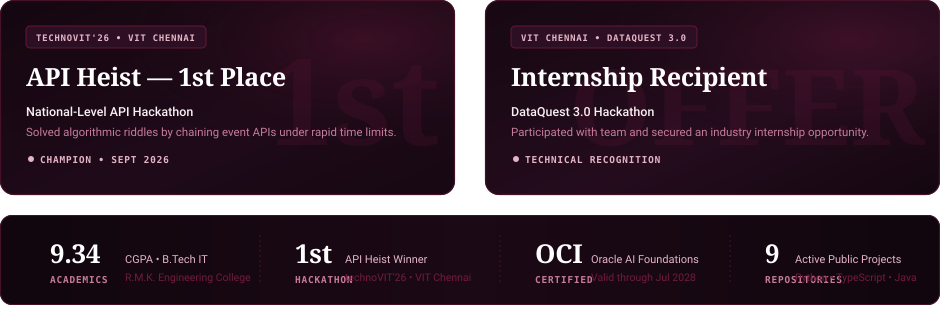
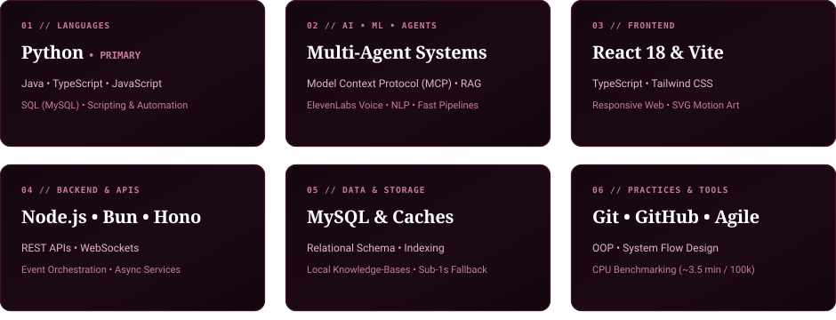

<div align="center">

<!-- Hero Banner with Embedded Portrait, Orbital Geometry & Burgundy Theme -->
<a href="https://github.com/bhuvaneshmp15-glitch">
  
</a>

<br><br>

<p align="center">
  <a href="https://github.com/bhuvaneshmp15-glitch">
    
  </a>
  &nbsp;&nbsp;
  <a href="https://www.linkedin.com/in/bhuvanesh-mp">
    
  </a>
  &nbsp;&nbsp;
  <a href="https://github.com/bhuvaneshmp15-glitch/LeetCode">
    
  </a>
  &nbsp;&nbsp;
  <a href="#01--about--hello-im-bhuvanesh">
    
  </a>
</p>

</div>

---

<br>

## 01 // ABOUT / Hello, I'm Bhuvanesh.

```
AI DEVELOPER • FULL-STACK ENGINEER • HACKATHON BUILDER
Based in Chennai, India // B.Tech in Information Technology @ R.M.K. Engineering College (2025–2029)
Academic Standing: CGPA 9.34
```

<div align="center">
  
</div>

<br>

<p align="center">
  
</p>

## 02 // RECOGNITION / Proof, on the record.

Every accomplishment below is verified against academic records, competitive hackathon jury results, and authenticated cloud credentials.

<div align="center">
  
</div>

<br>

#### Professional Certifications & Completed Internships
* **OCI Certified AI Foundations Associate** | *Oracle University* (Active: July 2026 – July 2028)  
  Validates core understanding of AI workloads, deep learning architectures, and Oracle Cloud Infrastructure AI services.
* **Software Engineering & Agile Development** | *Infosys Springboard* (September 2025)  
  Mastery of sprint planning, Scrum ceremonies, modular OOP design, and integration testing methodologies.
* **Soft Skill Development** | *NPTEL, IIT Kharagpur* (January 2026 – March 2026)  
  Structured curriculum in cross-functional technical communication, team collaboration, and analytical problem breakdown.
* **Python Programming Intern** | *Codtech IT Solutions Pvt. Ltd.* (May 2026 – June 2026)  
  Engineered a RAG chatbot, a desktop voice assistant powered by ElevenLabs, and an automated daily news briefing script. Earned official completion certification with formal technical recognition.
* **Full Stack Development Intern** | *Cognifyz Technologies* (October 2025 – November 2025)  
  Implemented modular web application components, state persistence, and responsive UI integrations.

<br>

<p align="center">
  
</p>

## 03 // PROJECTS / Selected shipped repositories.

Each featured project is real, tested, and directly accessible on GitHub with genuine source code.

| Repository & Focus | Verified Architecture & Capabilities | Core Tech Stack |
| :--- | :--- | :--- |
| [**Deep_Fit_Ai**](https://github.com/bhuvaneshmp15-glitch/Deep_Fit_Ai) | **Intelligent Candidate Ranking Engine**<br>Parses rich career narratives instead of relying on keyword matching. Runs 100% on CPU, processing 100k candidate profiles in ~3.5 minutes with honeypot anti-stuffing gating and hallucination-free reasoning for *Redrob India Runs*. | `Python` `NLP` `Machine Learning` `Fast CPU Pipeline` |
| [**VIDYAPRAYOG-2**](https://github.com/bhuvaneshmp15-glitch/VIDYAPRAYOG-2) | **LMI-CAP Platform (Labour Market &amp; Career Action)**<br>Analyzes live industry demand data, employer sentiment, and skill trends to map curriculum deficiencies and generate adaptive learning roadmaps. | `React 18` `Vite` `TypeScript` `Tailwind CSS` |
| [**automated-claims-engine**](https://github.com/bhuvaneshmp15-glitch/automated-claims-engine) | **Multimodal Claims Evidence Inspector**<br>Built for *HackerRank Orchestrate*, evaluating damage claim evidence across automobiles, consumer electronics, and logistics packages via automated visual-conversation pipelines. | `Python` `Computer Vision` `Claims Orchestration` |
| [**ayursutra**](https://github.com/bhuvaneshmp15-glitch/ayursutra) | **Clinical Protocol Care Management**<br>Healthcare workflow management engine structuring multi-stage Panchakarma treatment sequences and longitudinal patient care schedules. | `Bun` `Hono` `TypeScript` `Modern Web` |
| [**jarvis-assistant**](https://github.com/bhuvaneshmp15-glitch/jarvis-assistant) | **Local Desktop Voice Automation**<br>Voice agent linking real-time speech recognition to ElevenLabs natural voice generation for dynamic OS task dispatch and audio feedback. | `Python` `ElevenLabs` `SpeechRecognition` `pyttsx3` |
| [**chatterbot-project**](https://github.com/bhuvaneshmp15-glitch/chatterbot-project) | **Conversational NLP Dialogue Engine**<br>Automated dialogue management system training on conversation data structures to predict and produce context-aware responses. | `Python` `ChatterBot` `NLP` |

> [!NOTE]
> **Architectural Prototypes Documented on Resume:**  
> • **FarmLine (FarmCall):** Spoken multilingual phone-call voice advisory for farmers over Exotel, WebSockets, and Model Context Protocol (MCP) with local knowledge-base fallback (sub-4 second response target).  
> • **RideScoreIQ:** Two-wheeler telematics prototype evaluating Spectral Energy Ratio (FFT) to distinguish rough road jitter from aggressive riding for fair insurance underwriting.  
> *(Both are documented hackathon architectures; their private/offline codebases remain non-public).*

<br>

<p align="center">
  
</p>

## 04 // TECH STACK / The tools I build with.

Categorized strictly by technologies verified across shipped repositories, coursework, and practical implementations.

<div align="center">
  
</div>

<br>

<p align="center">
  
</p>

## 05 // COMMIT LOG / A year of building.

Live public contribution graph tracked in burgundy via GitHub's activity calendar:

<div align="center">

<a href="https://github.com/bhuvaneshmp15-glitch">
  
</a>

<p align="center"><sub><i>Contributions tracked live in Burgundy (#701A3D) via GitHub public contributions API.</i></sub></p>

</div>

<br>

<p align="center">
  
</p>

## 06 // VERIFIED PROFILE &amp; COORDINATES

<div align="center">

<table width="100%">
  <tr>
    <td align="left" width="50%">
      <b>Verified Coordinates</b><br>
      • <b>Institution:</b> R.M.K. Engineering College, Chennai<br>
      • <b>Degree Program:</b> B.Tech in Information Technology (2025–2029)<br>
      • <b>Academic Standing:</b> CGPA 9.34 (High Distinction)<br>
      • <b>Secondary Education:</b> Sethu Bhaskara Matric Hr.Sec School (HSC: 92.83% | SSLC: 91.4%)
    </td>
    <td align="left" width="50%">
      <b>Verified Professional Handles</b><br>
      • <b>GitHub:</b> <a href="https://github.com/bhuvaneshmp15-glitch">github.com/bhuvaneshmp15-glitch</a><br>
      • <b>LinkedIn:</b> <a href="https://www.linkedin.com/in/bhuvanesh-mp">linkedin.com/in/bhuvanesh-mp</a><br>
      • <b>Algorithm Practice:</b> <a href="https://github.com/bhuvaneshmp15-glitch/LeetCode">LeetCode Solutions Repo</a><br>
      • <b>Location:</b> Chennai, Tamil Nadu, India
    </td>
  </tr>
</table>

</div>

<br><br>

<div align="center">

<!-- Animated Minimal Burgundy Footer -->


</div>
