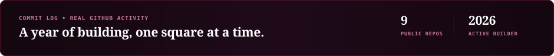
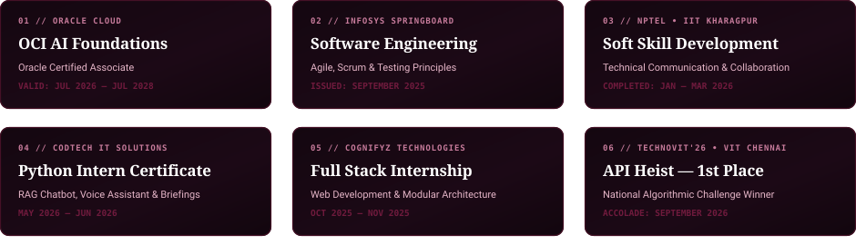

<div align="center">

<!-- Hero Banner with Embedded Portrait, Orbital Geometry & Editorial Typography -->
<a href="https://github.com/bhuvaneshmp15-glitch">
  
</a>

<br><br>

<p align="center">
  <a href="https://github.com/bhuvaneshmp15-glitch">
    
  </a>
  &nbsp;&nbsp;
  <a href="https://www.linkedin.com/in/bhuvanesh-mp">
    
  </a>
  &nbsp;&nbsp;
  <a href="https://github.com/bhuvaneshmp15-glitch/LeetCode">
    
  </a>
  &nbsp;&nbsp;
  <a href="#01--about--hello-im-bhuvanesh">
    
  </a>
</p>

</div>

---

<br>

## 01 // ABOUT / Hello, I'm Bhuvanesh.

```
AI DEVELOPER • FULL-STACK ENGINEER • HACKATHON BUILDER
Based in Chennai, India // B.Tech in Information Technology @ R.M.K. Engineering College (2025–2029)
Academic Standing: CGPA 9.34 // High Distinction
```

<div align="center">
  
</div>

<br>

<p align="center">
  
</p>

## 02 // RECOGNITION / Proof, on the record.

Every accomplishment below is verified against academic records, competitive hackathon jury results, and authenticated cloud credentials.

<div align="center">
  
</div>

<br>

<p align="center">
  
</p>

## 03 // SELECTED WORK / Products, not assignments.

Full systems engineered with architectural rigor, verified telemetry, and benchmarked execution.

<!-- Flagship Project Card 1: DeepFit AI -->
<div align="center">
  <a href="https://github.com/bhuvaneshmp15-glitch/Deep_Fit_Ai">
    
  </a>
</div>

<br>

<!-- Flagship Project Card 2: Automated Claims Engine -->
<div align="center">
  <a href="https://github.com/bhuvaneshmp15-glitch/automated-claims-engine">
    
  </a>
</div>

<br>

#### Additional Shipped Repositories

| Repository & Focus | Verified Architecture & Capabilities | Core Tech Stack |
| :--- | :--- | :--- |
| [**VIDYAPRAYOG-2**](https://github.com/bhuvaneshmp15-glitch/VIDYAPRAYOG-2) | **LMI-CAP Platform (Labour Market &amp; Career Action)**<br>Analyzes live industry demand data, employer sentiment, and skill trends to map curriculum deficiencies and generate adaptive learning roadmaps. | `React 18` `Vite` `TypeScript` `Tailwind CSS` |
| [**ayursutra**](https://github.com/bhuvaneshmp15-glitch/ayursutra) | **Clinical Protocol Care Management**<br>Healthcare workflow management engine structuring multi-stage Panchakarma treatment sequences and longitudinal patient care schedules. | `Bun` `Hono` `TypeScript` `Modern Web` |
| [**jarvis-assistant**](https://github.com/bhuvaneshmp15-glitch/jarvis-assistant) | **Local Desktop Voice Automation**<br>Voice agent linking real-time speech recognition to ElevenLabs natural voice generation for dynamic OS task dispatch and audio feedback. | `Python` `ElevenLabs` `SpeechRecognition` `pyttsx3` |
| [**chatterbot-project**](https://github.com/bhuvaneshmp15-glitch/chatterbot-project) | **Conversational NLP Dialogue Engine**<br>Automated dialogue management system training on conversation data structures to predict and produce context-aware responses. | `Python` `ChatterBot` `NLP` |

> [!NOTE]
> **Architectural Prototypes Documented on Resume:**  
> • **FarmLine (FarmCall):** Spoken multilingual phone-call voice advisory for farmers over Exotel, WebSockets, and Model Context Protocol (MCP) with local knowledge-base fallback (sub-4 second response target).  
> • **RideScoreIQ:** Two-wheeler telematics prototype evaluating Spectral Energy Ratio (FFT) to distinguish rough road jitter from aggressive riding for fair insurance underwriting.  
> *(Both are documented hackathon architectures; their private/offline codebases remain non-public).*

<br>

<p align="center">
  
</p>

## 04 // TECH STACK / The tools I build with.

Categorized strictly by technologies verified across shipped repositories, coursework, and practical implementations.

<div align="center">
  
</div>

<br>

<p align="center">
  
</p>

## 05 // COMMIT LOG / A year of building.

Live public contribution graph tracked in burgundy via GitHub's activity calendar:

<div align="center">



<br>

<a href="https://github.com/bhuvaneshmp15-glitch">
  
</a>

<p align="center"><sub><i>Contributions tracked live in Burgundy (#701A3D) via GitHub public contributions API.</i></sub></p>

</div>

<br>

<p align="center">
  
</p>

## 06 // CREDENTIALS &amp; CERTIFICATIONS

Verified industry credentials, competitive hackathon recognitions, and completed engineering coursework.

<div align="center">
  
</div>

<br>

<p align="center">
  
</p>

## 07 // CONNECT / Let's build something worth explaining.

<div align="center">

<table width="100%">
  <tr>
    <td align="left" width="50%">
      <b>Verified Coordinates</b><br>
      • <b>Institution:</b> R.M.K. Engineering College, Chennai<br>
      • <b>Degree Program:</b> B.Tech in Information Technology (2025–2029)<br>
      • <b>Academic Standing:</b> CGPA 9.34 (High Distinction)<br>
      • <b>Secondary Education:</b> Sethu Bhaskara Matric Hr.Sec School (HSC: 92.83% | SSLC: 91.4%)
    </td>
    <td align="left" width="50%">
      <b>Verified Professional Handles</b><br>
      • <b>GitHub:</b> <a href="https://github.com/bhuvaneshmp15-glitch">github.com/bhuvaneshmp15-glitch</a><br>
      • <b>LinkedIn:</b> <a href="https://www.linkedin.com/in/bhuvanesh-mp">linkedin.com/in/bhuvanesh-mp</a><br>
      • <b>Algorithm Practice:</b> <a href="https://github.com/bhuvaneshmp15-glitch/LeetCode">LeetCode Solutions Repo</a><br>
      • <b>Location:</b> Chennai, Tamil Nadu, India
    </td>
  </tr>
</table>

<br>

<!-- Glowing Signature Banner -->


<br><br>

<!-- Animated Minimal Burgundy Footer -->


</div>
